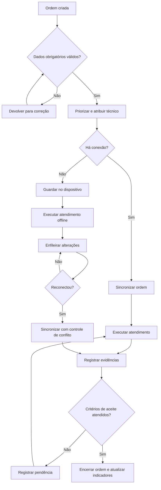

# Aula 05 - Análise da Qualidade do Projeto FieldOps

## 1. Objetivo e fonte dos dados

Esta análise aplica as sete ferramentas básicas da qualidade ao FieldOps. Como ainda não há dados reais de execução, foi criado um conjunto de dados de referência para o piloto, explicitamente tratado como **simulado**. O objetivo é demonstrar o método de coleta e análise que será usado quando os dados reais estiverem disponíveis.

Base simulada:

- 80 ocorrências de defeito registradas durante testes integrados;
- 90 medições de tempo de resposta da API;
- 8 ciclos semanais de teste;
- 6 módulos comparados quanto à cobertura de testes e defeitos escapados.

## 2. Critérios de qualidade e aceite

| Dimensão | Critério |
|---|---|
| Funcionalidade | 100% dos cenários críticos aprovados |
| Segurança | 0 vulnerabilidades críticas ou altas abertas no release |
| Desempenho | P95 da API principal <= 2,0 s com 50 usuários simultâneos |
| Offline | >= 95% dos registros sincronizados em até 5 minutos após reconexão |
| Usabilidade | Média >= 4,0/5,0 no piloto |
| Disponibilidade | >= 99% no período de piloto |
| Rastreabilidade | Toda ordem encerrada possui usuário, horário e evidência quando aplicável |

## 3. Ferramenta 1 - Diagrama de causa e efeito

Problema analisado: **ordens de serviço não sincronizam corretamente após o técnico recuperar a conexão**.

```text
Pessoas --------------------------\
- treinamento insuficiente         \
- desconhecimento do status         \
                                      > Falha de sincronização
Processo -------------------------/    após reconexão
- conflito de edição                /
- regra de reprocessamento ausente /

Tecnologia -----------------------\
- fila local sem idempotência       \
- timeout de API                    \
                                      > Causas a investigar
Dados ----------------------------/
- identificador duplicado          /
- relógio do dispositivo incorreto/

Ambiente -------------------------\
- sinal instável                    \
- troca de rede durante envio       \
                                      > Condições de campo
```

Conclusão: a causa não deve ser atribuída apenas à rede. O plano de ação precisa combinar treinamento, testes de conectividade, identificadores idempotentes, fila persistente, reprocessamento seguro e monitoramento de conflitos.

## 4. Ferramenta 2 - Fluxograma

Fluxo de atendimento utilizado para validar pontos de controle de qualidade:



Pontos de controle: validação de dados, persistência offline, sincronização idempotente, evidência obrigatória e aceite antes do encerramento.

## 5. Ferramenta 3 - Folha de verificação

| Tipo de ocorrência | Contagem | Percentual |
|---|---:|---:|
| Sincronização offline | 24 | 30,0% |
| Permissão e perfil | 16 | 20,0% |
| Desempenho | 13 | 16,25% |
| Interface e usabilidade | 11 | 13,75% |
| Integração externa | 8 | 10,0% |
| Notificação | 5 | 6,25% |
| Relatório / indicador | 3 | 3,75% |
| **Total** | **80** | **100%** |

## 6. Ferramenta 4 - Pareto

| Ordem | Categoria | Ocorrências | % acumulado |
|---:|---|---:|---:|
| 1 | Sincronização offline | 24 | 30,00% |
| 2 | Permissão e perfil | 16 | 50,00% |
| 3 | Desempenho | 13 | 66,25% |
| 4 | Interface e usabilidade | 11 | 80,00% |
| 5 | Integração externa | 8 | 90,00% |
| 6 | Notificação | 5 | 96,25% |
| 7 | Relatório / indicador | 3 | 100,00% |

As quatro primeiras categorias concentram 64 de 80 ocorrências (80%). A prioridade de melhoria deve ser sincronização, autorização, desempenho e usabilidade antes de investir em refinamentos de menor frequência.

## 7. Ferramenta 5 - Histograma

Distribuição simulada do tempo de resposta da API principal:

| Faixa de tempo | Medições |
|---|---:|
| 0,0 a 0,5 s | 2 |
| 0,5 a 1,0 s | 8 |
| 1,0 a 1,5 s | 18 |
| 1,5 a 2,0 s | 24 |
| 2,0 a 2,5 s | 20 |
| 2,5 a 3,0 s | 10 |
| 3,0 a 3,5 s | 5 |
| 3,5 a 4,0 s | 3 |
| **Total** | **90** |

```text
0,0-0,5 | ██ 2
0,5-1,0 | ████████ 8
1,0-1,5 | ██████████████████ 18
1,5-2,0 | ████████████████████████ 24
2,0-2,5 | ████████████████████ 20
2,5-3,0 | ██████████ 10
3,0-3,5 | █████ 5
3,5-4,0 | ███ 3
```

44 medições ficaram até 2,0 s e 46 acima do limite de referência. O resultado indica necessidade de otimização ou de revisão da carga representativa antes do aceite de desempenho.

## 8. Ferramenta 6 - Gráfico de controle

Defeitos encontrados por ciclo semanal:

| Ciclo | Defeitos | Média de referência | Limite superior | Limite inferior |
|---:|---:|---:|---:|---:|
| 1 | 14 | 9,4 | 20,5 | 0 |
| 2 | 12 | 9,4 | 20,5 | 0 |
| 3 | 13 | 9,4 | 20,5 | 0 |
| 4 | 10 | 9,4 | 20,5 | 0 |
| 5 | 9 | 9,4 | 20,5 | 0 |
| 6 | 8 | 9,4 | 20,5 | 0 |
| 7 | 5 | 9,4 | 20,5 | 0 |
| 8 | 4 | 9,4 | 20,5 | 0 |

Os limites foram estimados pela média mais ou menos três desvios-padrão do conjunto. Não há ponto fora dos limites; a sequência descendente sugere efeito positivo das correções, mas deve ser acompanhada para confirmar estabilidade e evitar mascarar defeitos por redução de testes.

## 9. Ferramenta 7 - Diagrama de dispersão

Relação simulada entre cobertura de testes e defeitos escapados por módulo:

| Módulo | Cobertura de testes | Defeitos escapados |
|---|---:|---:|
| Autenticação | 62% | 9 |
| Ordens de serviço | 68% | 7 |
| Agenda | 74% | 6 |
| Inventário | 79% | 4 |
| Dashboard | 84% | 3 |
| Evidências móvel | 90% | 1 |

```text
Defeitos escapados
9 | ●
8 |
7 |     ●
6 |          ●
5 |
4 |               ●
3 |                    ●
2 |
1 |                         ●
  +----------------------------
    60  65  70  75  80  85  90  Cobertura (%)
```

Há associação negativa no conjunto: módulos com maior cobertura apresentaram menos defeitos escapados. A relação não prova causalidade, mas justifica elevar cobertura e testes de cenários críticos como ação de melhoria.

## 10. Plano de ação e conclusão

| Prioridade | Ação | Responsável | Evidência |
|---|---|---|---|
| Alta | Corrigir fila offline, idempotência e conflitos | Backend / Mobile | Teste offline aprovado |
| Alta | Revisar matriz de papéis e autorização | Segurança / Backend | Casos de permissão aprovados |
| Alta | Otimizar endpoints acima de 2 s | Backend / DevOps | Relatório de carga |
| Média | Repetir testes de usabilidade com técnicos | UX / Operações | Média >= 4,0/5,0 |
| Média | Padronizar contratos de integração | Tech lead | Contratos versionados |

O FieldOps deve priorizar prevenção de defeitos nas etapas de requisitos, arquitetura e desenvolvimento. A aplicação das sete ferramentas evidencia que qualidade é uma atividade contínua, baseada em dados e ligada aos critérios de aceite do projeto.
