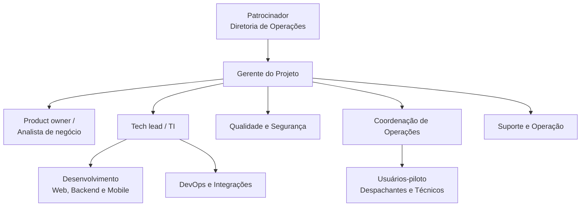

# Aula 06 - Organograma e Matriz RACI do Projeto FieldOps

## 1. Organograma

## 2. Papéis e responsabilidades

| Papel | Responsabilidades principais |
|---|---|
| Patrocinador | Fornecer direção, aprovar mudanças relevantes, remover impedimentos e aceitar o resultado |
| Gerente do projeto | Integrar escopo, prazo, custo, riscos, comunicação e decisões |
| Product owner / Analista | Priorizar necessidades, manter backlog, validar requisitos e representar o valor do produto |
| Tech lead / TI | Definir arquitetura, orientar construção, gerir integrações e decisões técnicas |
| Desenvolvimento | Construir os módulos web, backend e mobile, corrigir defeitos e manter documentação técnica |
| DevOps e Integrações | Configurar ambientes, automações, observabilidade e conexões externas |
| Qualidade e Segurança | Definir critérios, executar testes, avaliar vulnerabilidades e recomendar aceite |
| Operações | Representar o processo de negócio, disponibilizar usuários e aprovar o uso funcional |
| Usuários-piloto | Validar fluxos reais, registrar feedback e participar do treinamento |
| Suporte | Receber a transferência, operar o hiper cuidado e registrar incidentes |

## 3. Matriz RACI

Legenda: **R** = Responsável pela execução; **A** = Aprovador/accountable; **C** = Consultado; **I** = Informado.

| Atividade / entrega | Sponsor | Gerente | Operações | Tech/TI | Desenvolvimento | QA/Sec | Suporte | Usuários |
|---|---|---|---|---|---|---|---|---|
| Aprovar TAP | A | R | C | C | I | C | I | I |
| Integrar plano e baseline | I | A/R | C | C | I | C | I | I |
| Identificar partes interessadas | C | A/R | C | C | I | I | I | C |
| Levantar requisitos | I | R | A | C | C | C | I | R/C |
| Priorizar backlog do MVP | C | R | A | C | C | C | I | C |
| Aprovar arquitetura e segurança | I | C | C | A/R | C | R/C | I | I |
| Definir modelo de dados e APIs | I | C | C | A/R | R | C | I | I |
| Construir módulo web | I | C | C | A | R | C | I | I |
| Construir aplicativo móvel/offline | I | C | C | A | R | C | I | C |
| Configurar ambientes e CI/CD | I | C | I | A | C | C | R | I |
| Planejar e executar testes | I | C | C | C | R | A/R | I | C |
| Homologar funcionalmente | I | R | A | C | C | R | I | R/C |
| Preparar e executar piloto | C | R | A | C | C | R | R | R |
| Aprovar implantação | A | R | C | C | I | C | C | I |
| Realizar handover e suporte | I | A | C | R/C | C | C | R | I |
| Encerrar e registrar lições | A | R | C | C | I | C | C | C |

## 4. Regras de alocação

1. Cada linha possui um aprovador principal; quando houver duas marcações A em uma mesma linha, a segunda representa participação de aceite do negócio ou da área técnica e deve ser resolvida no plano de governança.
2. O Tech lead não aprova sozinho mudanças de escopo, custo ou prazo.
3. Usuários-piloto devem ser consultados antes da homologação e responsáveis pela execução dos cenários de uso durante o piloto.
4. QA/Sec pode bloquear o release quando houver defeito crítico ou vulnerabilidade incompatível com o critério de aceite.
5. O gerente mantém a matriz atualizada quando houver mudança de equipe ou responsabilidade.
