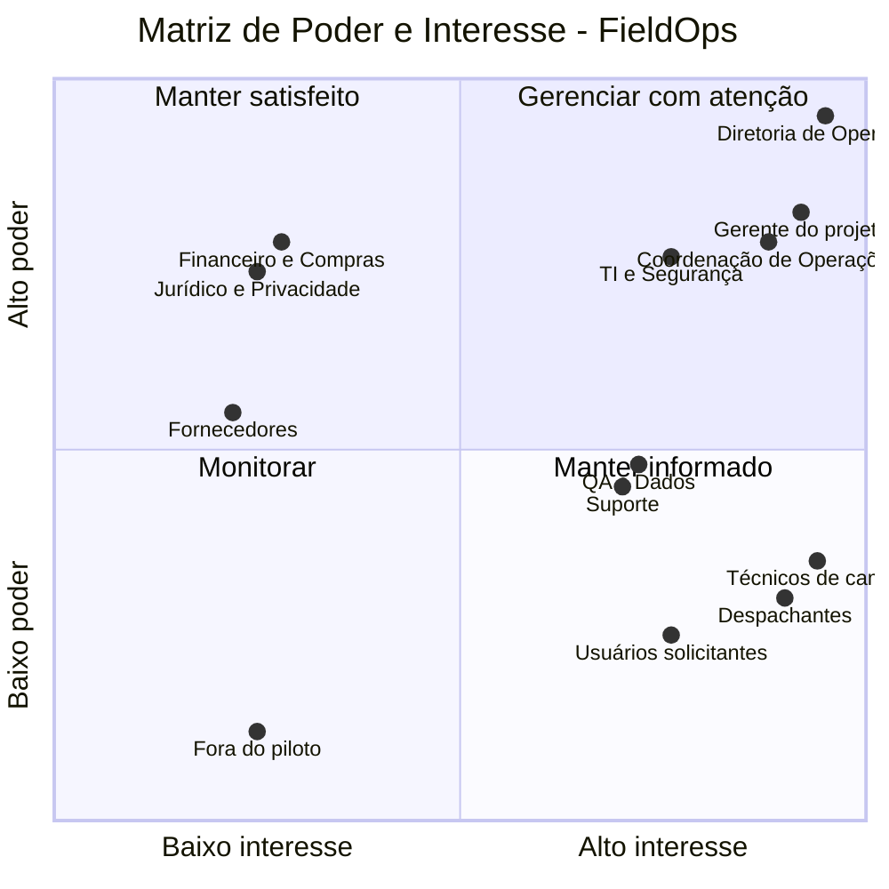

# Aula 08 - Matriz de Poder/Interesse do Projeto FieldOps

## 1. Critério de classificação

Poder e interesse recebem notas de 1 a 5. A classificação usa os quadrantes pedidos na atividade:

- **Gerenciar com atenção:** alto poder e alto interesse;
- **Manter satisfeito:** alto poder e baixo interesse;
- **Manter informado:** baixo poder e alto interesse;
- **Monitorar:** baixo poder e baixo interesse.

## 2. Registro das partes interessadas

| Parte interessada | Papel / expectativa | Poder | Interesse | Quadrante | Estratégia |
|---|---|---:|---:|---|---|
| Diretoria de Operações / sponsor | Valor, prazo, orçamento e decisão | 5 | 5 | Gerenciar com atenção | Status executivo, decisões e escalonamento |
| Coordenação de Operações | Dono do processo e aceite funcional | 4 | 5 | Gerenciar com atenção | Participação semanal, validação e gestão de mudanças |
| Gerente do projeto | Integração e coordenação do trabalho | 4 | 5 | Gerenciar com atenção | Comunicação diária da equipe e controle integrado |
| TI e Segurança | Arquitetura, acesso e conformidade | 4 | 4 | Gerenciar com atenção | Revisões técnicas e alertas de risco |
| Financeiro e Compras | Controle de orçamento e contratos | 4 | 2 | Manter satisfeito | Relatórios de custo e solicitações formais |
| Jurídico / Privacidade | Requisitos legais e tratamento de dados | 4 | 2 | Manter satisfeito | Consultar em pontos de decisão e auditoria |
| Fornecedores de nuvem e APIs | Disponibilidade e suporte contratado | 3 | 2 | Manter satisfeito | Acompanhar SLA, consumo e incidentes |
| Técnicos de campo | Usabilidade, rapidez e operação offline | 2 | 5 | Manter informado | Testes, treinamento e feedback frequente |
| Despachantes | Agenda, priorização e acompanhamento | 2 | 5 | Manter informado | Demonstrações e validação de fluxo |
| Usuários solicitantes | Abertura e acompanhamento das ordens | 2 | 4 | Manter informado | Guias, comunicados e pesquisa de satisfação |
| Equipe de suporte | Operação, chamados e continuidade | 3 | 4 | Manter informado | Handover, manuais e participação no piloto |
| QA e analistas de dados | Critérios, indicadores e evidências | 3 | 4 | Manter informado | Relatórios de qualidade e sessões técnicas |
| Colaboradores fora do piloto | Impacto futuro, mas sem decisão imediata | 1 | 2 | Monitorar | Comunicação geral quando houver expansão |
| Comunidade / usuários externos | Possível impacto indireto | 1 | 1 | Monitorar | Monitorar feedback e requisitos futuros |

## 3. Matriz visual

## 4. Plano de engajamento

| Grupo | Resultado desejado | Ação no ciclo de vida | Indicador |
|---|---|---|---|
| Gerenciar com atenção | Decisão rápida e alinhamento | Reuniões de marco, status e registro de decisões | Decisões críticas em até 2 dias |
| Manter satisfeito | Apoio sem sobrecarga de comunicação | Consultas em mudanças, contratos e conformidade | Aprovações sem retrabalho |
| Manter informado | Uso efetivo e feedback confiável | Demos, piloto, treinamento e boletins | Participação >= 80% |
| Monitorar | Evitar surpresa na expansão | Comunicados de impacto e pesquisa eventual | Incidentes de expectativa não tratados = 0 |

## 5. Mudança de classificação

O poder e o interesse podem mudar durante o projeto. O gerente revisará o registro em cada marco e sempre que houver mudança organizacional, incidente, alteração de escopo, entrada de fornecedor ou expansão do piloto. Qualquer parte interessada que passe a bloquear decisão, adoção ou aceite deve ser reclassificada e receber estratégia de maior envolvimento.
